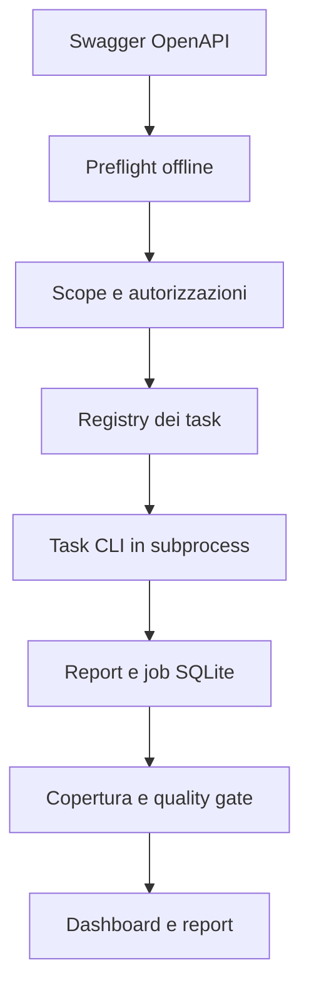

# Architettura commentata — AchillesAPI v0.90

Questo documento è una mappa per capire il codice senza conoscere tutto il repository.
Le funzioni aggiunte nella v0.90 hanno **docstring brevi in italiano** e commenti soltanto dove è necessario spiegare una decisione o un limite di sicurezza.

## Flusso di una suite



1. La dashboard carica una specifica tramite un ID opaco, mai un percorso arbitrario.
2. `campaign_preflight` determina i prerequisiti **senza HTTP**.
3. `run_suite` verifica scope e consenso, poi visita il registro in ordine.
4. `run_tool` crea argomenti CLI da una lista fissata, senza invocare una shell.
5. Ogni risultato è collegato al job principale; i job e contesti non segreti finiscono in SQLite.
6. `assess_campaign_quality` indica mancanze e copertura senza emettere certificazioni di sicurezza.

## Dove si trova ogni funzione

| File | Funzione principale | Cosa fa |
| --- | --- | --- |
| `core/registry_v090.py` | `TOOLS`, `SUITE_ORDER` | Catalogo fisso e ordine dei task, condiviso tra CLI e dashboard |
| `core/campaign_v090.py` | `campaign_preflight` | Valuta i prerequisiti di ogni task senza effettuare richieste |
| `core/workflow_dependencies_v090.py` | `infer_dependencies` | Ipotizza relazioni tra collection e endpoint con ID |
| `core/risk_matrix_v090.py` | `build_risk_matrix` | Associa endpoint a ipotesi OWASP API Top 10, senza finding |
| `core/auth_audit_v090.py` | `audit_auth` | Verifica schemi e profili, non mostra i token |
| `core/verification_v090.py` | `review_assessment` | Deduplica indicatori e suggerisce prove da raccogliere |
| `core/quality_v090.py` | `assess_campaign_quality` | Evidenzia errori, task saltati e operazioni non osservate |
| `core/compatibility_v080.py` | `analyze_compatibility` | Matrice OpenAPI per operazione e misure di osservazione |
| `core/auth.py` | `load_authentication_manager` | Carica i profili Bearer, Basic, API key, OAuth2 e login JSON |
| `dashboard/control.py` | `run_tool`, `run_suite`, `stop_suite` | Prepara i comandi, esegue la campagna e gestisce lo stop cooperativo |
| `dashboard/server.py` | `create_app`, `_safe_error` | Espone la dashboard locale e oscura credenziali negli errori |
| `dashboard/persistence_v080.py` | `CampaignStore` | Salva job e contesti non segreti in SQLite |
| `dashboard/job_view.py` | `safe_tree`, `viewer_payload` | Sanifica i dati prima di mostrarli al browser |
| `dashboard/static/app.js` | `previewSuite`, `runSuite`, `stopSuite` | Comandi dell'interfaccia per pianificare, avviare e fermare |
| `dashboard/static/job-viewer.js` | `renderSuite`, `renderQualityPanel`, `renderRiskPanel` | Risultati interattivi senza inserire HTML non attendibile |

## Esempi di commenti chiari

```python
# Non inviare la richiesta: qui analizziamo soltanto lo Swagger.
coverage = analyze_compatibility(spec)

# Un task dipendente dagli HTTP result aspetta il job precedente.
state = "waiting_for_result"

# Fermare la suite TRA i job evita di tranciare un cleanup in corso.
if stop_requested:
    break
```

## Regole da seguire quando aggiungi un test

1. Definisci la funzione CLI e aggiungi il comando al registry fisso.
2. Indica se necessita di OpenAPI, assessment, auth, manifest, scope o traffico attivo.
3. Non fare HTTP in una funzione dichiarata offline.
4. Per richieste attive verifica lo scope in esecuzione, non solo nel preflight.
5. Non usare `shell=True` né argomenti di terminale forniti dal browser.
6. Registra osservazioni reali: non trasformare segnali o ipotesi in conferme.
7. Non mettere token, body o header autenticati nei report; prova i casi di redazione.
8. Aggiungi test con almeno un secondo schema OpenAPI non legato al laboratorio.
9. Documenta cosa viene saltato e perché; un esito incompleto non è un pass.

## Cosa rimane da fare dopo la v0.90

- Verificare la suite su API reali e diverse con una ground truth indipendente.
- Rendere più ricca la gestione di OAuth2/SSO e dei refresh specifici dell'applicazione.
- Migliorare la telemetria HTTP: la riserva attuale è conservativa ma non costituisce un conteggio affidabile di tutto il traffico.
- Raccogliere prove riproducibili e oscurate per BOLA/BFLA e workflow business complessi.
- Validare la pulizia di fixture anche in condizioni di crash, con test di fault injection.
